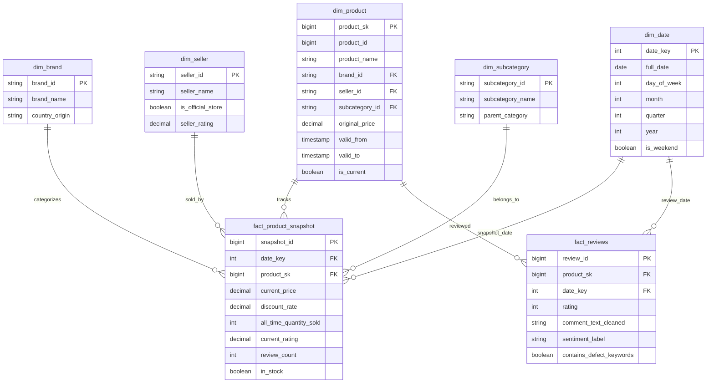

# 📊 Data Model & Schema Specification

## 1. Dimensional Model (Star Schema) - Gold Layer

---

## 2. Medallion Layer Schema Progression

### 🥉 Bronze Layer (Raw Streaming/Batch Dump)
- Format: Delta Lake / Raw JSON strings
- Partition: `event_date` (`YYYY-MM-DD`)
- Attributes: Unmodified payload from Tiki API + ingestion metadata (`_ingested_at`, `_source_topic`, `_offset`).

### 🥈 Silver Layer (Cleaned & Conformed)
- Format: Delta Lake
- Transformations:
  - Deduplication via `(product_id, crawl_date)`
  - Data hygiene: trim strings, normalize brand names, remove HTML tags from reviews
  - Anonymization: SHA256 hashed customer identifiers
  - Calculated columns: `discount_rate_calc = (original_price - price) / original_price`
  - Validation: flag anomalies (`is_price_anomaly`, `is_rating_invalid`)

### 🥇 Gold Layer (Star Schema & Business Aggregations)
- Storage: Delta Lake + Synced to PostgreSQL `dwh` & `analytics` schemas
- Optimized for BI reporting and sub-second Power BI querying.
